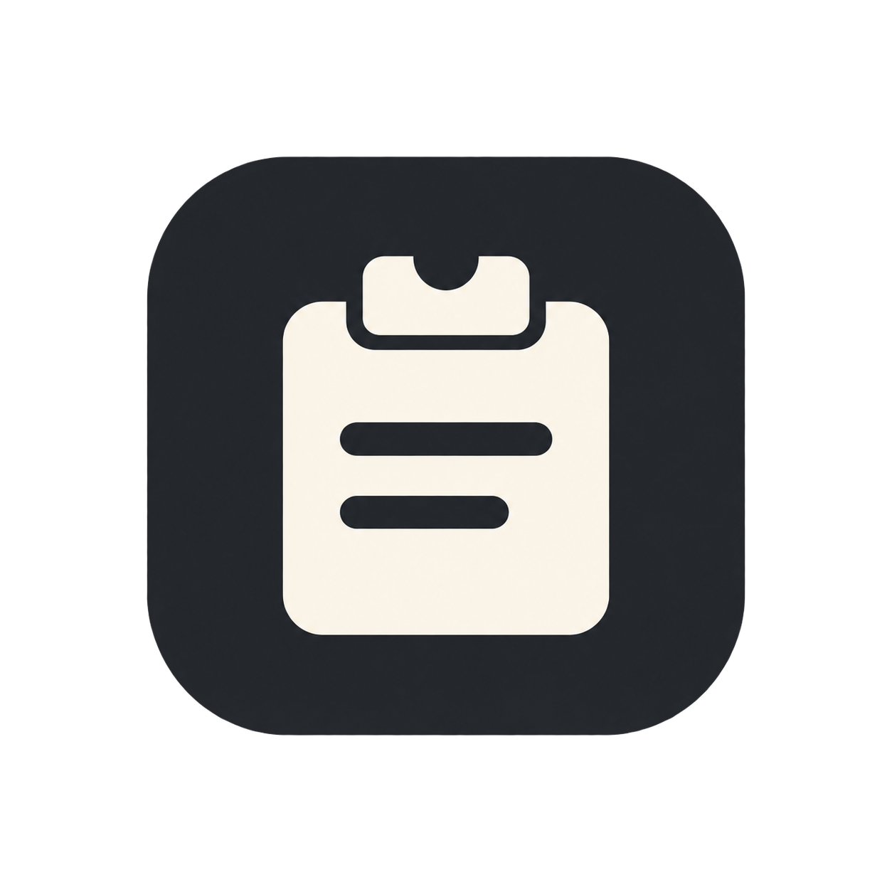

<p align="center">
  
</p>

<h1 align="center">ClipNotch</h1>

<p align="center">
  A light, fast clipboard manager for the notch of your Mac. It can fill web forms too.
</p>

<p align="center">
  <a href="https://clipnotch.pranavvijay.me/">Website</a> ·
  <a href="https://github.com/Son-Of-Zeus/ClipNotch/releases/latest">Latest release</a> ·
  <a href="LICENSE">MIT License</a>
</p>

ClipNotch is a menu-bar app for macOS 14 or later. It keeps what you copy and gives it back from a drawer at the top of the screen. It is free and open source, and it makes no network requests.

## Install

```sh
curl -fsSL https://clipnotch.pranavvijay.me/install.sh | sh
```

The script downloads the latest release, checks its SHA-256 checksum and its code signature, copies the app to `/Applications` and opens it. Run the same command again to update.

You can also download the zip from the [releases page](https://github.com/Son-Of-Zeus/ClipNotch/releases/latest). ClipNotch is not notarized, so macOS blocks a browser download the first time. Open the app once, then go to System Settings > Privacy & Security and select **Open Anyway**.

The app is universal (Apple silicon and Intel). It needs the Accessibility permission to read the shortcut, paste into the active app and read browser forms. The first launch shows you how to grant it.

## Features

### Clipboard history

- Hold `⌘` and press `J`. The history drops from the notch with your text, rich text, images and files.
- Keep `⌘` held. Press `K` to move down the list and `J` to move up.
- Release `⌘`. The selected item goes into the app that you are in.

If you prefer, change the interaction from **Hold to paste** to **Toggle drawer** in Settings > Shortcuts. You can also change the two navigation keys there.

### Data Palette

Save a detail once and use it again: an email, a phone number, a portfolio link. Details are grouped in profiles such as Personal and Work. Press `⌘⇧J` to open the Data Palette, pick a detail and a profile, then release `⌘` to paste the value.

### Form autofill

When a form opens in Chrome or Safari, ClipNotch offers to fill it from a profile. There is no browser extension.

- It always asks first. Nothing is filled until you agree.
- It does not fill passwords, one-time codes or captchas.
- You can exclude a site, or turn autofill off in Settings.

## Privacy

- There is no account, no sync and no analytics. The app makes no network requests.
- The clipboard history and the Data Palette are stored in SQLite databases on your Mac.
- History expires after one day and holds 10 items by default. You can change both limits in Settings > Storage.

## Build from source

You need Xcode with the macOS 14 SDK or later. There are no package dependencies.

```sh
git clone https://github.com/Son-Of-Zeus/ClipNotch.git
cd ClipNotch
xcodebuild -project ClipNotch.xcodeproj -scheme ClipNotch -configuration Debug build
```

For normal development, open `ClipNotch.xcodeproj` in Xcode and run the **ClipNotch** scheme.

To run the tests, quit any running ClipNotch first. The tests use the app as their host, and the app permits only one instance.

```sh
xcodebuild -project ClipNotch.xcodeproj -scheme ClipNotch test
```

## Project structure

| Path | Contents |
| --- | --- |
| `ClipNotch/Core/` | Pasteboard monitor, clipboard history, event taps, shortcuts and browser form reading |
| `ClipNotch/Presenter/` | Panel presentation, paste delivery, form-fill delivery and the Accessibility guide |
| `ClipNotch/Storage/` | SQLite persistence for the history and the Data Palette |
| `ClipNotch/Models/` | Persisted and UI-facing data types |
| `ClipNotch/Views/` | SwiftUI screens and rows |
| `ClipNotch/Utilities/` | Shared design and screen helpers |
| `ClipNotchTests/` | XCTest target |

## Contributing

Issues and pull requests are welcome. [AGENTS.md](AGENTS.md) describes the code style, the test guidelines, the commit format and the release steps. In a pull request, explain the user-visible change, note how you verified it, and add a screenshot or a short recording for UI changes.

## License

[MIT](LICENSE). Made by [Pranav Vijay](https://pranavvijay.me).
